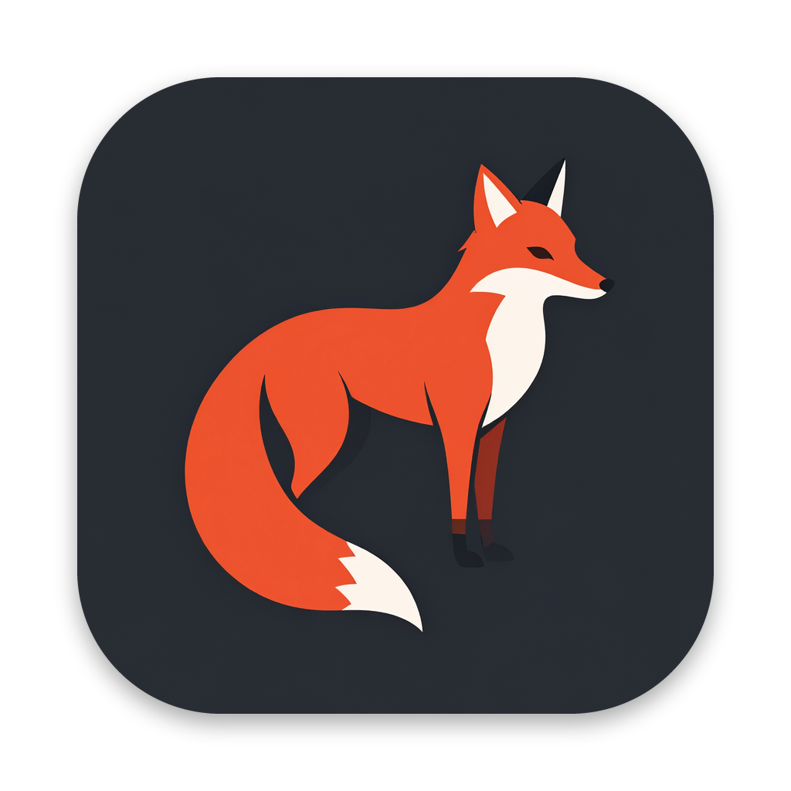

<p align="center"></p>

# Redfox

Redfox is a personal menu bar utility for the Mac that converts, compresses and edits files right where you drag them. It was written from scratch in Swift and SwiftUI, and all of the processing happens on your own machine, so nothing is ever uploaded anywhere.

## Installing Redfox

1. Open the [latest release](https://github.com/rohitDurbha/Redfox/releases/latest) and download the file called Redfox.dmg.
2. Open the disk image and drag the Redfox icon onto the Applications folder shown beside it.
3. Open Redfox from your Applications folder, and look for the small fox that appears in your menu bar.

### The first launch on a new Mac

Redfox is signed for personal use and is not notarized by Apple, so macOS asks for your permission the very first time you open it. When the warning appears, close it and then open System Settings, choose Privacy and Security, scroll down to the message about Redfox, and click Open Anyway. You only need to do this once, because every later update installs itself without the warning.

If you prefer Terminal, this single command removes the warning flag as well.

```
xattr -dr com.apple.quarantine /Applications/Redfox.app
```

### Updates

Redfox checks GitHub for a newer release about once a day, and you can also choose Check for Updates from the fox menu at any time. When a new version exists, clicking Install and Relaunch downloads the new disk image, replaces the app in place and opens the new version for you.

### Every format is built in

Redfox ships with its own copy of the open source [ffmpeg](https://ffmpeg.org) media engine inside the app, so MKV, WebM, AVI, MP3, FLAC, OGG, Opus, WebP and AVIF all work right after you install it. You do not need Homebrew or any other separate download.

## Using Redfox

Start dragging any file in Finder, and while you are still holding the mouse button, tap one of the keys below. A glass wheel grows out of your pointer, and dropping the file onto a segment runs that action and reveals the result in Finder.

| Key while dragging | Wheel | What you can do |
| --- | --- | --- |
| Shift | Convert | Turn images, videos, audio, PDFs, documents and subtitles into other formats, or pack them into an archive |
| Command | Tools | Compress, edit, crop, redact, annotate, trim, split, change speed, view or remove metadata and more |
| Control | Actions | AirDrop, float on a shelf, copy, move, copy the path or open the folder in Terminal |

As you move a file across the wheel, each petal you pass gives a light tap on the trackpad and a soft click, which makes the wheel feel tactile. You can choose how strong the tap is, pick a different sound or turn either one off in Settings, which opens from the fox menu or with Command and comma.

Every result is saved beside the original with a short suffix such as "compressed" or "edited", and Redfox never overwrites the file you started with.

## About the bundled media engine

The ffmpeg binary comes from the static Apple silicon builds published at [ffmpeg.martin-riedl.de](https://ffmpeg.martin-riedl.de), and its version is pinned in `scripts/fetch-ffmpeg.sh`. Each build checks the download against its published checksum, and the release workflow then tests every encoder Redfox uses before it publishes a new disk image. ffmpeg is free software released under the GPL, and its complete source code is available from [ffmpeg.org](https://ffmpeg.org/download.html).

## How releases are made

Every push to the main branch starts the workflow in `.github/workflows/release.yml`, which builds Redfox on a GitHub Mac, packages Redfox.dmg and publishes it as the newest release. The version number is `1.0.` followed by the workflow run number, so each push produces a higher version that the app recognizes as an update. Pull requests are built and checked in the same way, but they do not publish a release.

You can follow each build on the [Actions page](https://github.com/rohitDurbha/Redfox/actions), and a failed build there means the release was not published.

## Building on your own Mac

You rarely need this, because GitHub builds every release for you. If you want to try a change locally before pushing it, install the command line tools once with `xcode-select --install` and then run the script below from the project folder.

```
scripts/install-local.sh
```

## Project layout

| Path | Purpose |
| --- | --- |
| `Sources/Redfox/App.swift` | App entry point, menu bar menu, theme, windows, alerts and toasts |
| `Sources/Redfox/Wheel.swift` | Drag detection, the radial glass wheel and its drop handling |
| `Sources/Redfox/Core.swift` | File kinds, paths, the bundled ffmpeg, the wheel catalogs and job wiring |
| `Sources/Redfox/JobRunner.swift` | Background jobs and the progress cards |
| `Sources/Redfox/ImageEngine.swift` | Image conversion, compression, metadata, QR reading and backgrounds |
| `Sources/Redfox/MediaEngine.swift` | Video and audio conversion, compression and editing |
| `Sources/Redfox/DocEngine.swift` | PDF, document, subtitle, archive and metadata handling |
| `Sources/Redfox/Editors.swift` | Image editor, background editor, compress dialog, trim player, metadata viewer and PDF organizer |
| `Sources/Redfox/Shelf.swift` | File actions and the floating shelf |
| `Sources/Redfox/Onboarding.swift` | The welcome screens |
| `Sources/Redfox/Feedback.swift` | Haptic and sound feedback for the wheel, stored preferences and the Settings window |
| `Sources/Redfox/Updater.swift` | Checks GitHub releases and installs updates in place |
| `scripts/build-app.sh` | Compiles the code, bundles ffmpeg and assembles Redfox.app |
| `scripts/fetch-ffmpeg.sh` | Downloads the pinned static ffmpeg build and verifies its checksum |
| `scripts/smoke-test-ffmpeg.sh` | Runs every ffmpeg conversion against the bundled copy before a release |
| `scripts/make-dmg.sh` | Wraps the app in a drag to install disk image |
| `scripts/install-local.sh` | Builds and installs the app on the current Mac |
